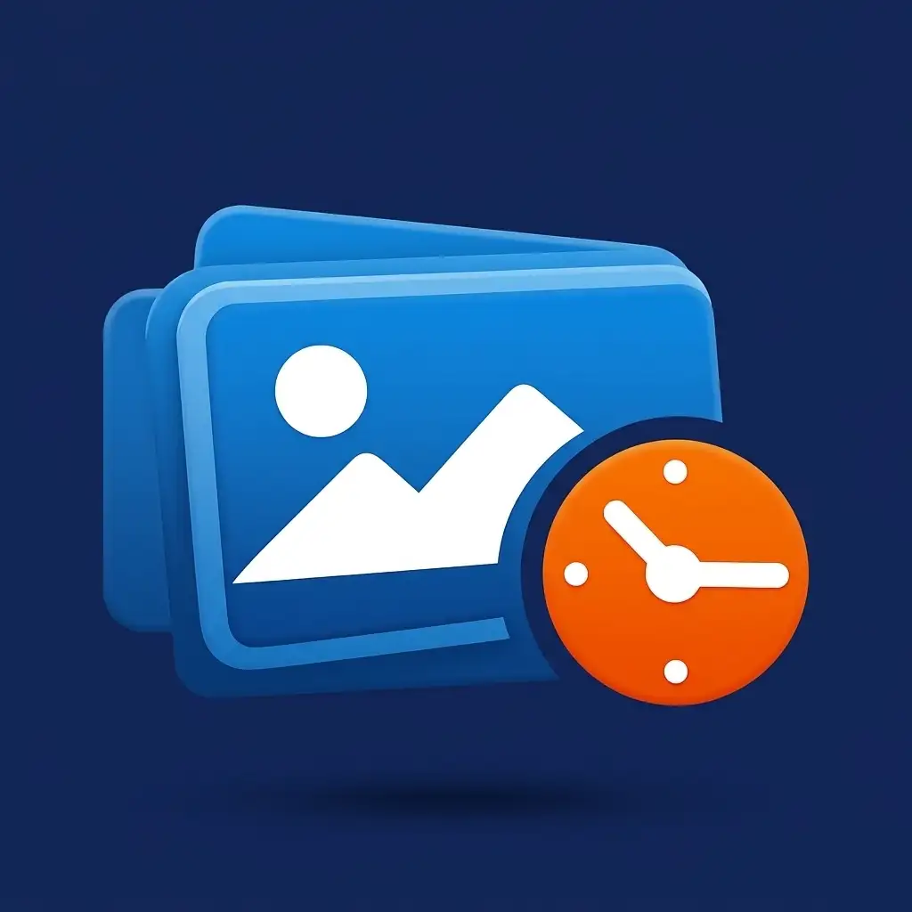

<h1 align="center">
  
  <br/>ShotKeeper
</h1>

<p align="center">
  
  
  
  
</p>

<p align="center">Screenshot retention manager. Capture. Organize. Search. Secure.</p>

---

## Features
- Capture and retain screenshots securely
- **Auto-pilot**: new screenshots are scheduled for deletion automatically (set it once, forget it)
- **Trash with undo**: deletions land in a 7-day trash first — restore or delete permanently anytime
- **Keep Forever** pins protect important screenshots from every deletion path
- Search through your library by filename with one-tap clear icon
- Schedule auto-deletion with custom timers
- Batch operations on multiple screenshots (schedule, pin, delete)
- Reliable background detection — revives itself after reboot, app update or system kill
- Clean Material design UI

## Download

**Latest:** [ShotKeeper-v1.4.0-release.apk](releases/ShotKeeper-v1.4.0-release.apk) — Swipeable fullscreen viewer, pinch-to-zoom, native Share, Hero transitions (v1.4.0)

**Previous:** [ShotKeeper-v1.1-release.apk](releases/ShotKeeper-v1.1-release.apk) — Search functionality (v1.1.0)  
[ShotKeeper-v1.0-release.apk](releases/ShotKeeper-v1.0-release.apk) — Initial release

## Build

```bash
flutter pub get
flutter build apk --release
```

## License

MIT — see [LICENSE](LICENSE)
